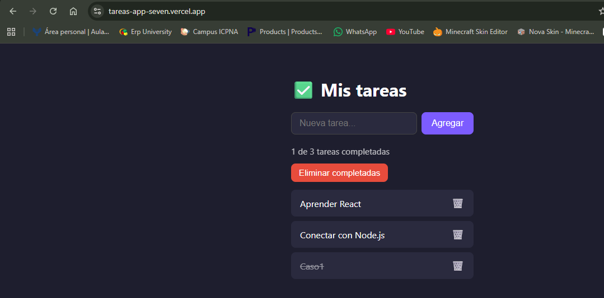
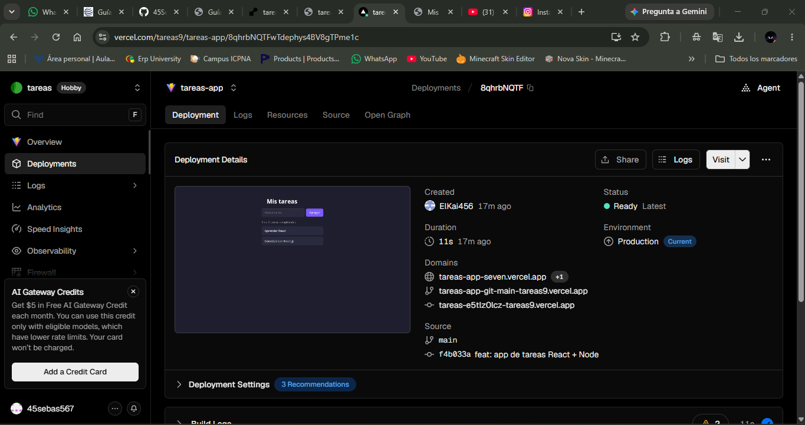
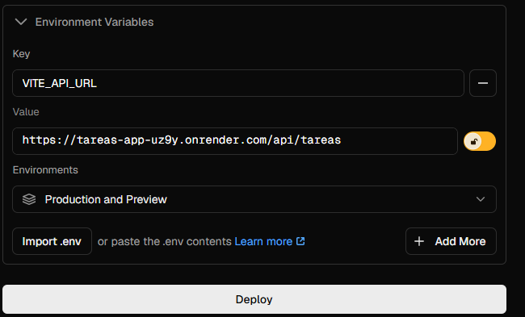
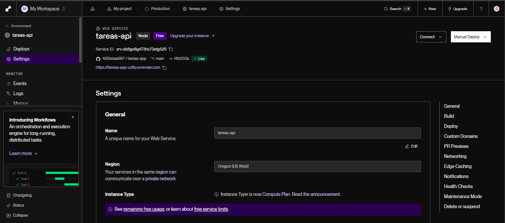
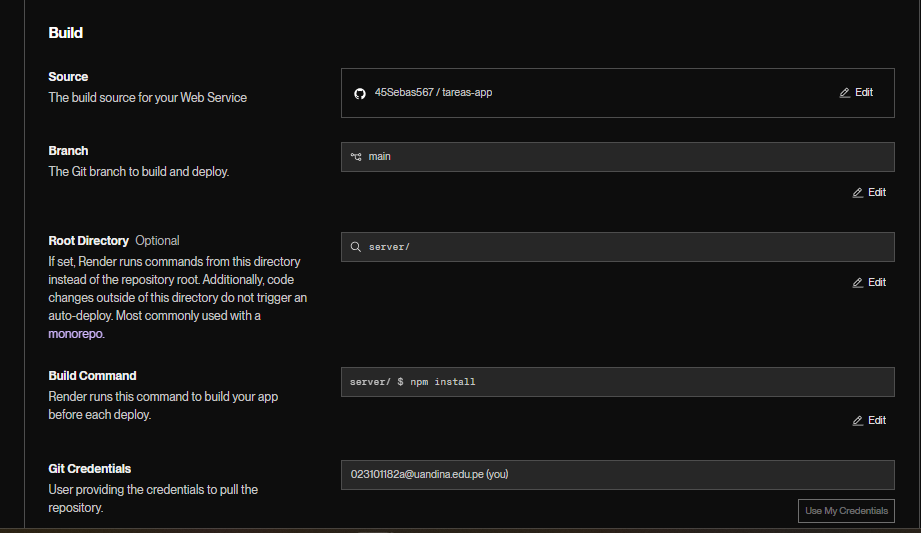
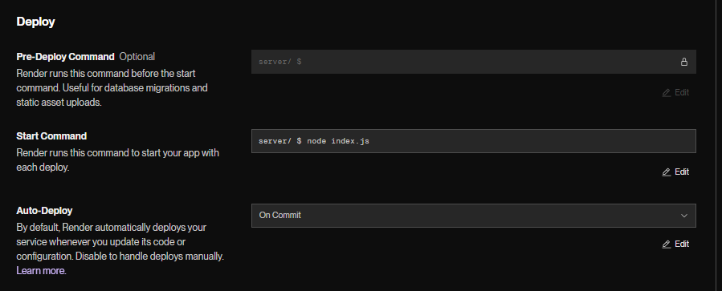
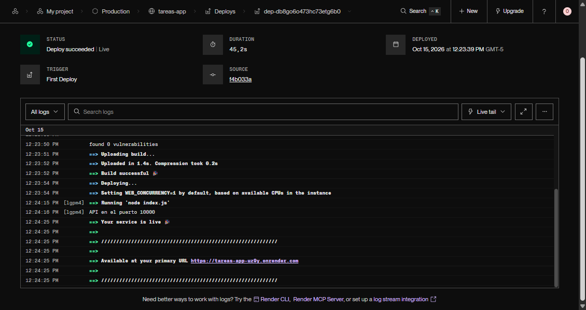
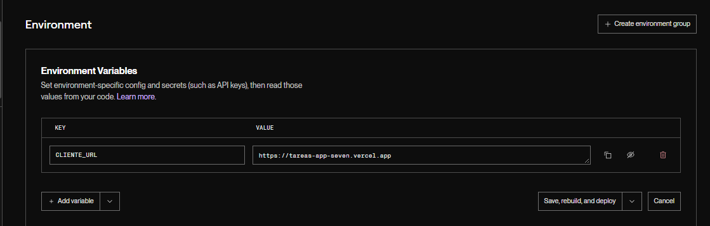
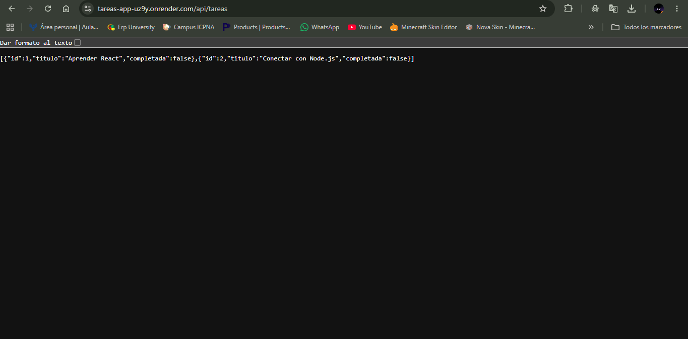
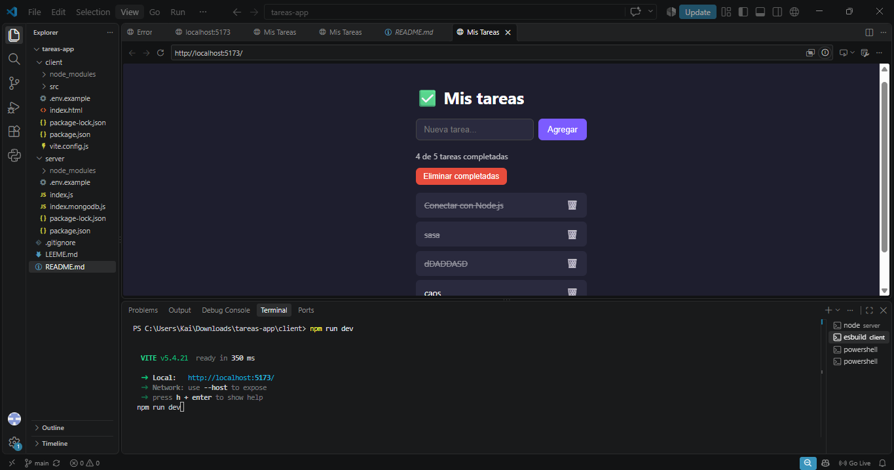

# ✅ App de Tareas — React + Node.js

Aplicación full-stack: frontend React (Vite) + API REST con Node.js y Express.
Curso: Plataformas para el Desarrollo de Aplicaciones — Semestre 2026-II.

## 🌐 URLs en vivo

- Frontend (Vercel): https://tareas-app-seven.vercel.app
- API (Render): https://tareas-app-uz9y.onrender.com/api/tareas

> La API está en el plan gratuito de Render: tras 15 minutos sin uso se "duerme" y la primera petición puede tardar cerca de 1 minuto.

## Ejecutar en local (dos terminales)

**Terminal 1 — Backend**

    cd server
    npm install
    npm run dev        # http://localhost:3001

**Terminal 2 — Frontend**

    cd client
    npm install
    npm run dev        # http://localhost:5173

## Endpoints de la API

| Método | Ruta              | Descripción                                   |
|--------|-------------------|-----------------------------------------------|
| GET    | /api/tareas       | Obtener todas las tareas                      |
| POST   | /api/tareas       | Crear una tarea                               |
| PUT    | /api/tareas/:id   | Completar/descompletar y/o editar el título   |
| DELETE | /api/tareas/:id   | Eliminar una tarea                            |

## Funciones

- Crear, completar (clic), editar (doble clic) y eliminar tareas
- Contador de tareas completadas
- Botón "Eliminar completadas"
- Opcional: persistencia con MongoDB Atlas (`npm run dev:mongo`, ver `server/.env.example`)

## Variables de entorno

| Variable      | Dónde        | Para qué                                        |
|---------------|--------------|-------------------------------------------------|
| VITE_API_URL  | Vercel       | URL de la API en producción                     |
| CLIENTE_URL   | Render       | URL del frontend (restringe CORS)               |
| MONGODB_URI   | Render/local | Cadena de conexión de MongoDB (solo Reto 4)     |

## Despliegue

| Parte    | Plataforma | Configuración                                                    |
|----------|------------|------------------------------------------------------------------|
| Backend  | Render     | Root Directory `server`, Build `npm install`, Start `node index.js`, plan Free |
| Frontend | Vercel     | Root Directory `client`, Build `npm run build`, Output `dist`    |

Ambos se redespliegan automáticamente con cada `git push` a la rama `main`.
CORS está restringido: la variable `CLIENTE_URL` de Render contiene solo la URL del frontend en Vercel.

## Capturas

### App en vivo (Vercel)

### Frontend en Vercel

### Backend en Render

### API respondiendo en la nube

### Desarrollo local

